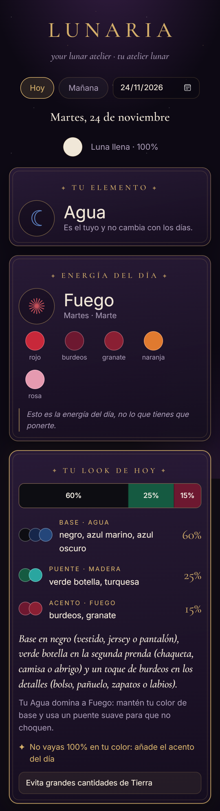
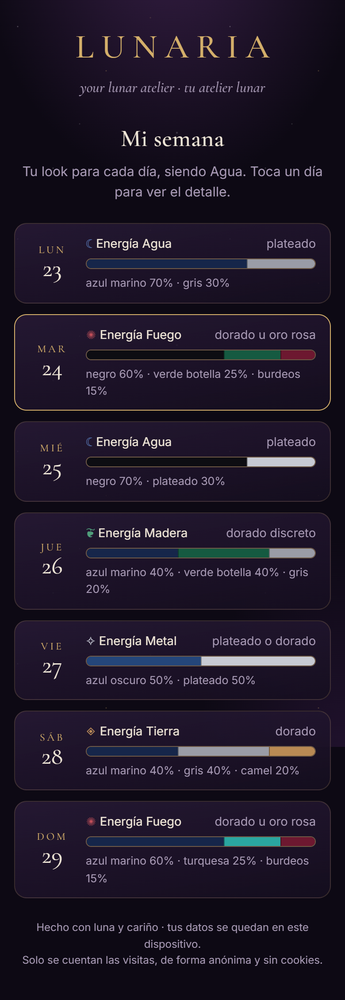
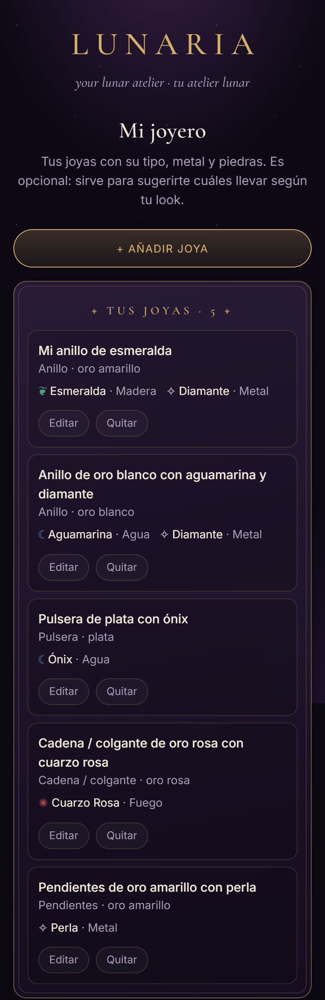

# ☾ Lunaria

*your lunar atelier · tu atelier lunar*

Lunaria es una web app en español que recomienda qué **ropa y accesorios** ponerse cada día según el **feng shui de los 5 elementos** (Agua, Metal, Madera, Fuego y Tierra). Calcula tu elemento personal, lo cruza con la energía del día de la semana y te propone un look en proporciones concretas, con tonos, metal y joyas.

**Demo:** https://lyn-devstack.github.io/lunaria/

<!-- Capturas: guárdalas en docs/screenshots/ y descomenta -->
<!--
| Hoy | Mi semana | Mi joyero |
| --- | --- | --- |
|  |  |  |
-->

## Qué hace

- **Onboarding mínimo:** solo mes y año de nacimiento. Enero cuenta como el año anterior; en febrero pregunta si naciste antes del 4.
- **Tu elemento:** por la última cifra del año (0-1 Metal · 2-3 Agua · 4-5 Madera · 6-7 Fuego · 8-9 Tierra). Editable en Ajustes.
- **Tres secciones con nombres fijos** para no confundir:
  - *Tu elemento*: el tuyo, no cambia.
  - *Energía del día*: elemento y colores del día. No es lo que te tienes que poner.
  - *Tu look de hoy*: la única parte que dice qué ponerse (barra de proporciones, frase de look y el porqué).
- **Accesorios:** metal del día y, si quieres, *Mi joyero*: marcas tus joyas (metal + piedra) y la app sugiere las que encajan con el look.
- **Mi semana:** los 7 días con su look. Selector para consultar mañana u otra fecha.
- **Fase lunar** calculada en local, sin APIs.
- **Sin backend:** todo se guarda en `localStorage`.

## Cómo decide el look

Sea `U` el elemento de la usuaria y `D` el del día. Con 5 elementos, cada pareja cae en exactamente una relación:

| Relación | Reparto |
| --- | --- |
| `U = D` (día fuerte) | U 70% · nutridor de U 30% |
| `D` genera a `U` (día ideal) | D 50% · U 50% |
| `U` genera a `D` (el día te consume) | D 40% · U 40% · nutridor de U 20% |
| `U` controla a `D` (choque) | U 60% · puente 25% · D 15% + aviso |
| `D` controla a `U` (choque) | puente 40% · U 40% · D 20% |

- Ciclo generador: Madera → Fuego → Tierra → Metal → Agua → Madera.
- Ciclo de control: Madera → Tierra → Agua → Fuego → Metal → Madera.
- Cada parte tiene un rol: **base** (la mayor), **puente** y **acento** (la menor).
- Dentro de un elemento se sugiere el **tono más cercano** a tu energía (para Agua en día de Fuego: burdeos o granate antes que rojo vivo).
- Lenguaje cuidado: nunca dice «evita X» si X aparece en el look; entonces dice «no más del N% de X».

## Estructura

```
src/
├─ data/        colores, días, ciclos y joyas (solo datos)
├─ logic/       funciones puras y testeadas: elemento, relaciones, motor, accesorios, luna, semana
├─ storage/     lectura/escritura validada de localStorage
├─ hooks/       perfil y fecha seleccionada
├─ components/  layout, ui (carta de tarot), onboarding, today, week, jewelry
└─ pages/       Onboarding, Today, Week, Jewelry, Settings
```

La lógica vive separada de la interfaz: `recommend(U, D)` es una función pura que devuelve el look completo, por eso se puede probar sin renderizar nada.

## Desarrollo

```bash
npm install
npm run dev      # servidor local
npm test         # tests unitarios (Vitest)
npm run build    # typecheck + build de producción
```

## Despliegue

Cada push a `main` ejecuta `.github/workflows/deploy.yml`: instala, pasa los tests, construye y publica en GitHub Pages. Vite está configurado con `base: '/lunaria/'`.
Solo la primera vez: en el repositorio, *Settings → Pages → Source: GitHub Actions*.

## Notas y limitaciones

- La fecha de corte de febrero es el **4** fijo; el inicio real del año solar cae entre el 3 y el 5.
- Las tablas de tonos «más cercanos» (`src/data/elements.ts`) son una interpretación editable.
- La fase lunar usa el ciclo sinódico medio (precisión de ±1 día).

## Proceso

Diseñé el producto y sus reglas (elementos, ciclos, proporciones, lenguaje de la interfaz). El proyecto está construido con asistencia de IA (Claude Code); reviso y entiendo cada parte del código.

## Stack

React 18 · Vite · TypeScript · Vitest · CSS propio · GitHub Pages
