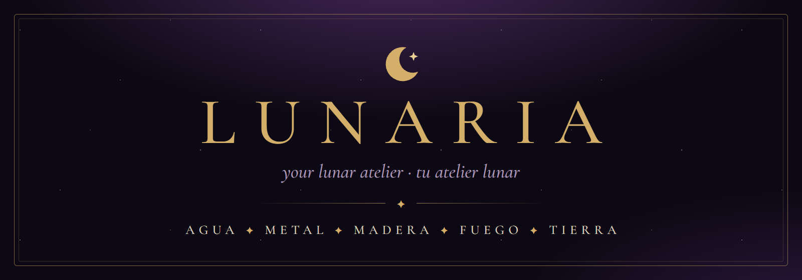
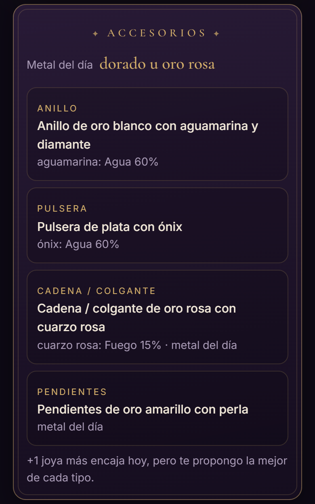
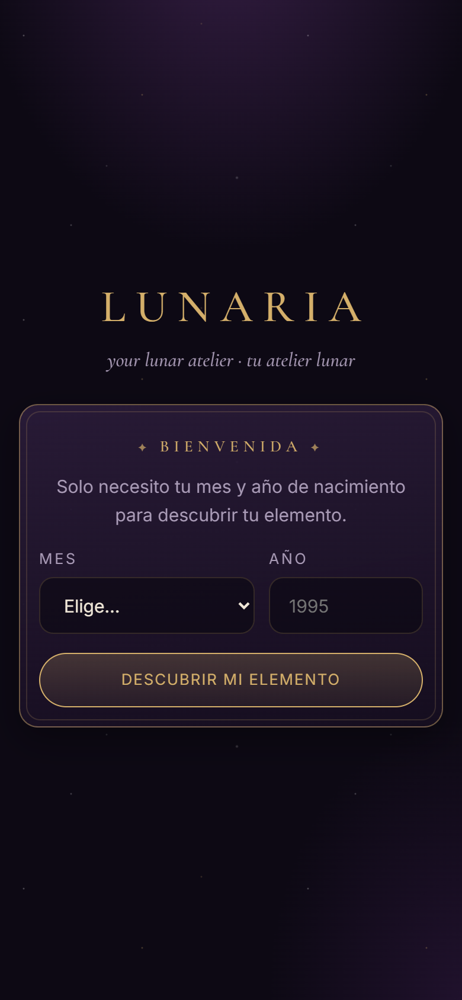

<div align="center">



<br />

### Qué ponerte hoy, según la energía del día

Una web app mística y elegante que traduce el **feng shui de los 5 elementos**<br />
en un look diario: colores, proporciones, metales y joyas.

<br />

**[ ✦ &nbsp;Abrir Lunaria&nbsp; ✦ ](https://lyn-devstack.github.io/lunaria/)**

<br />


</div>

<br />

<p align="center">✦ &nbsp; ✦ &nbsp; ✦</p>

## ☾ &nbsp;Una mirada

<table>
  <tr>
    <td align="center" valign="top" width="33%">
      <br />
      <sub><b>Hoy</b> · elemento, energía del día y look</sub>
    </td>
    <td align="center" valign="top" width="33%">
      <br />
      <sub><b>Accesorios</b> · el metal del día y tus joyas</sub>
    </td>
    <td align="center" valign="top" width="33%">
      <br />
      <sub><b>Mi semana</b> · los 7 días de un vistazo</sub>
    </td>
  </tr>
  <tr>
    <td align="center" valign="top">
      <br />
      <sub><b>Mi joyero</b> · tus joyas reales</sub>
    </td>
    <td align="center" valign="top">
      <br />
      <sub><b>Bienvenida</b> · solo mes y año</sub>
    </td>
    <td></td>
  </tr>
</table>

<sub>Capturas de ejemplo con elemento Agua, un martes (día de Fuego).</sub>

<br />

<p align="center">✦ &nbsp; ✦ &nbsp; ✦</p>

## ✧ &nbsp;La idea

Cada día de la semana tiene un elemento (el lunes es Agua por la Luna, el martes Fuego por Marte…) y cada persona tiene el suyo según su año de nacimiento. Lunaria cruza los dos y responde a una pregunta sencilla: **¿qué me pongo hoy?**

Para que nunca confunda, la app habla siempre con tres secciones y los mismos nombres:

> **Tu elemento** &nbsp;·&nbsp; el tuyo. No cambia con los días.
>
> **Energía del día** &nbsp;·&nbsp; el elemento y los colores del día. *Esto es la energía del día, no lo que tienes que ponerte.*
>
> **Tu look de hoy** &nbsp;·&nbsp; la **única** parte que dice qué ponerse: barra de proporciones con muestras de color, una frase de ejemplo y el porqué en una línea.

Nunca dice «evita X» si X aparece en tu look: en ese caso dice «no más del N% de X».

<br />

## ❦ &nbsp;Lo que hace

- **Bienvenida mínima.** Solo mes y año de nacimiento. Enero cuenta como el año anterior; en febrero pregunta si naciste antes del 4. El elemento sale de la última cifra del año y se puede cambiar en Ajustes.
- **Looks con armonía.** Elige tonos que combinan entre sí, siempre dentro de los colores de tu elemento y del día. Descarta parejas que chocan (verde con rojo, que parece Navidad) y varía cada día y cada semana para que no se repita.
- **Accesorios.** El metal del día y, si quieres, **Mi joyero**: añades tus joyas reales (anillo, cadena/colgante, pulsera, pendientes) con su metal y una o varias piedras. Lunaria te propone la mejor de cada tipo y te dice por qué.
- **Mi semana.** Los 7 días con su look, y un selector para consultar mañana u otra fecha.
- **Fase lunar** calculada en el propio dispositivo, sin APIs.
- **Instalable en el móvil**, con icono propio, como una app.

<br />

<p align="center">✦ &nbsp; ✦ &nbsp; ✦</p>

## ✺ &nbsp;Cómo decide el look

Sea **U** el elemento de la usuaria y **D** el del día. Con 5 elementos, cada pareja cae en exactamente una relación:

| Relación | Reparto del look |
| :-- | :-- |
| **U = D** · día fuerte | U 70% · nutridor de U 30% |
| **D genera a U** · día ideal | D 50% · U 50% |
| **U genera a D** · el día te consume | D 40% · U 40% · nutridor de U 20% |
| **U controla a D** · choque | U 60% · puente 25% · D 15% *(y un aviso)* |
| **D controla a U** · choque | puente 40% · U 40% · D 20% |

<sub>Ciclo generador: Madera → Fuego → Tierra → Metal → Agua → Madera. &nbsp;·&nbsp; Ciclo de control: Madera → Tierra → Agua → Fuego → Metal → Madera.</sub>

Cada parte tiene un rol: **base** (la mayor), **puente** y **acento** (la menor, para los detalles). Dentro de un elemento se prefiere el tono más cercano al tuyo: para Agua en un día de Fuego, burdeos o granate antes que rojo vivo.

<br />

## ◈ &nbsp;Detrás de escena

Un proyecto pequeño con decisiones cuidadas:

- **La lógica vive aparte de la interfaz.** `recommend(U, D)` es una función pura que devuelve el look completo, así que se prueba sin renderizar nada.
- **86 tests** con Vitest: el cálculo del elemento (incluidos enero y febrero), las 25 combinaciones del motor, el lenguaje del límite, la armonía de tonos, las joyas, la luna y la semana.
- **La armonía de color es datos, no código.** Las listas de parejas que chocan y de las que combinan están en [`src/data/harmony.ts`](src/data/harmony.ts), y se ajustan sin tocar el motor.
- **Un test protege contra la Navidad:** comprueba en las 25 parejas y varias semanas que ningún look muestra una combinación prohibida.
- **Sin backend y con privacidad.** Todo se guarda en `localStorage`. Solo hay un contador de visitas anónimo y sin cookies ([GoatCounter](https://www.goatcounter.com)): no recibe el mes ni el año de nacimiento, el elemento ni las joyas.
- **Migración de datos.** El perfil está versionado; al cambiar el formato del joyero, la versión anterior se migra sin perder el elemento ni la fecha.

```
src/
├─ data/        colores, días, ciclos, armonía y joyas (solo datos)
├─ logic/       funciones puras y testeadas: elemento, relaciones, motor, tonos, accesorios, luna, semana
├─ storage/     lectura y escritura validada de localStorage
├─ hooks/       perfil y fecha seleccionada
├─ components/  layout, ui (carta de tarot), onboarding, today, week, jewelry
└─ pages/       Onboarding, Today, Week, Jewelry, Settings
```

<br />

<p align="center">✦ &nbsp; ✦ &nbsp; ✦</p>

## ☾ &nbsp;Para correrla tú

```bash
npm install
npm run dev      # servidor local
npm test         # tests unitarios
npm run build    # typecheck + build de producción
```

**Despliegue.** Cada push a `main` ejecuta [`deploy.yml`](.github/workflows/deploy.yml): instala, pasa los tests, construye y publica en GitHub Pages (Vite con `base: '/lunaria/'`). Solo la primera vez hay que activar, en el repositorio, *Settings → Pages → Source: GitHub Actions*.

## ✦ &nbsp;Notas y límites

- El corte de febrero es el **4** fijo; el inicio real del año solar cae entre el 3 y el 5.
- Las tablas de tonos «más cercanos» y de armonía son una interpretación editable.
- La fase lunar usa el ciclo sinódico medio (precisión de ±1 día).
- No funciona sin conexión: no incluye caché offline.

## ❦ &nbsp;Proceso

Diseñé el producto y sus reglas (elementos, ciclos, proporciones, lenguaje de la interfaz). El proyecto está construido con asistencia de IA (Claude Code); reviso y entiendo cada parte del código.

<br />

<p align="center">
  <sub>Hecho con luna y cariño ☾</sub>
</p>
